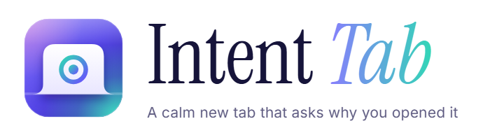
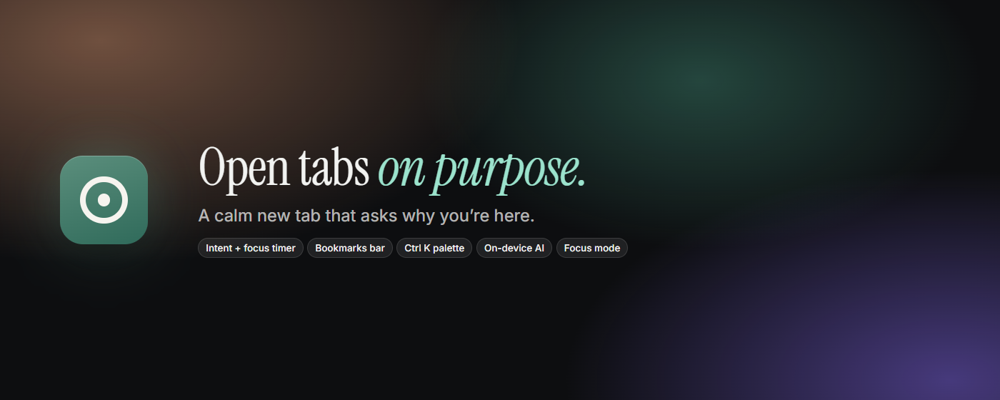
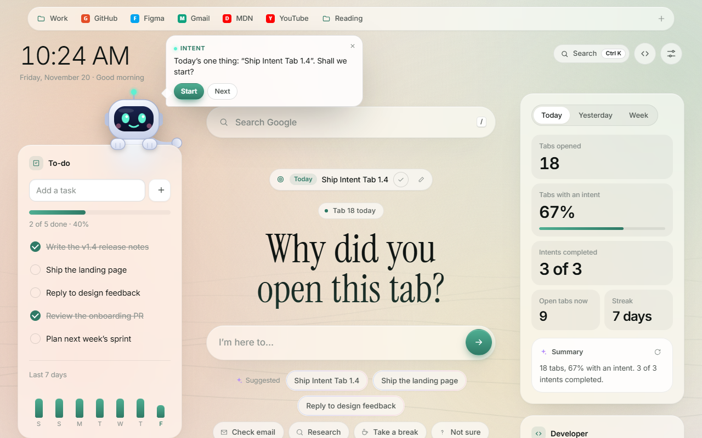
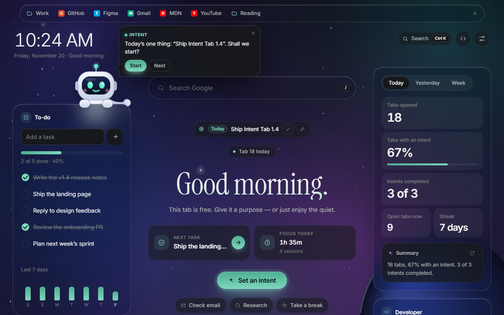
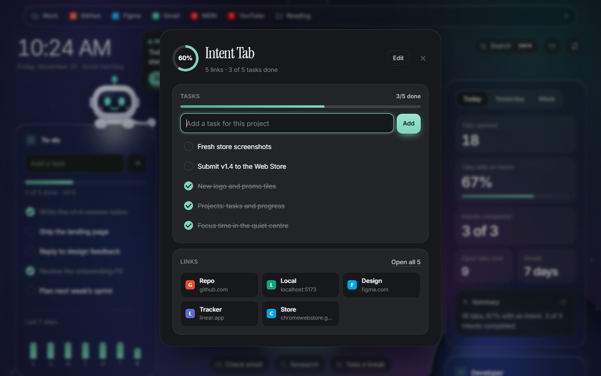

<div align="center">

<picture>
  <source media="(prefers-color-scheme: dark)" srcset="store/brand/wordmark-dark.png">
  
</picture>

### A calm new tab that asks one question: *“Why did you open this tab?”*

To-dos, projects, a focus timer, bookmarks and on-device AI. Everything stays on your computer.




</div>

---

## ✨ Why

Most tabs are opened out of habit. Intent Tab asks you why you opened each one, gently. You can pick a reason with one click or skip the question, and the search bar always works. Over a day you open more tabs on purpose and fewer by reflex.

- 🔒 **Private.** Everything is stored in `chrome.storage.local`. There's no server, no account, no analytics and no tracking.
- 🪶 **Light.** It's plain HTML, CSS and ES modules, with no framework and no build step. Animations pause when the page is idle.
- 🌏 **Bilingual.** It works fully in English and বাংলা, with Bangla digits too.

## 📸 Screenshots

| | |
|:---:|:---:|
|  |  |
| **The question:** set an intent in one click | **Cosmos:** next task, focus time and Intent the robot |
|  |  |
| **Ctrl+K:** do anything from the keyboard | **Projects:** tasks, progress and links in one popup |

<p align="center"><br><b>Focus mode:</b> distracting sites can wait while an intent runs</p>

## 🚀 Install

> Not on the Chrome Web Store yet. Load it unpacked, which takes about 30 seconds.

1. Download or clone this repository.
2. Open **`chrome://extensions`** in Chrome.
3. Turn on **Developer mode** (top right).
4. Click **Load unpacked** and select this folder (the one with `manifest.json`).
5. Open a new tab. If Chrome asks about the changed new tab page, choose **Keep it**.

After you edit a file, click ↻ on the extension card and open a new tab.

> **The bar under the page** ("Intent Tab · Customize Chrome") comes from Chrome itself. Chrome adds it to every extension's new tab, and extensions can't hide it. To turn it off: **Customize Chrome → Footer → turn off "Show footer"**. Intent Tab shows this tip once.

<details>
<summary><b>ইনস্টল (বাংলায়)</b></summary>

1. এই রিপোজিটরি ডাউনলোড বা clone করুন।
2. Chrome-এ **`chrome://extensions`** খুলুন।
3. উপরে ডানদিকের **Developer mode** চালু করুন।
4. **Load unpacked** চাপুন, তারপর এই ফোল্ডারটা (যেখানে `manifest.json` আছে) সিলেক্ট করুন।
5. নতুন ট্যাব খুলুন। Chrome জিজ্ঞেস করলে **Keep it** চাপুন।

</details>

## 🧭 Highlights

| | Feature | What it does |
|:-:|---|---|
| 🎯 | **Intent question** | Type a reason or pick a chip. Your intent then shows large, with a focus timer and **Done**. |
| 🌌 | **Cosmos** | A deep-space sky with stars, a nebula, shooting stars and a ringed planet. In light mode it's a pastel sky. |
| 🤖 | **Intent, the robot** | A small robot that peeks over your To-do card, points at the next task and cheers when you finish one. |
| ✅ | **To-do and today's one thing** | Daily tasks with progress and a 7-day chart, plus one goal for the day. |
| 🗂️ | **Projects** | Links, tasks and progress for each project, in a popup that opens with one click. |
| ⏱️ | **Focus time** | Counts how long you really focused today, with a session count. |
| 🛡️ | **Focus mode** | Distracting sites you choose redirect to a calm page while an intent runs. |
| 🧠 | **On-device AI** | Suggestions, a coach, a day summary and Ask AI, all from Gemini Nano on your computer. |
| ⌨️ | **Command palette** | Press Ctrl+K to search bookmarks, run tools, set intents and change settings. |
| 🛠️ | **Developer card** | Seven dev tools, search shortcuts and your projects on the page. |
| 🔖 | **Bookmarks bar** | A full bookmarks bar with folders, drag and drop, a right-click menu and custom icons. |
| 🌧️ | **Focus sounds** | Rain, ocean or fan noise, generated live with Web Audio. |

## 📖 Features in detail

<details>
<summary><b>🎯 Intent, timer and when to ask</b></summary>

- **Intent question.** Type a reason or pick a chip (*Check email, Research, Take a break, Not sure*). The intent then shows large, with a focus timer and **Done** / **New intent** buttons. The top line shows which tab of the day this is.
- **Timer length.** Choose 5, 10 (the default), 25 or 50 minutes in Settings, or switch under a running timer. After 20 or more minutes, **Take a 5-min break** appears.
- **When to ask** (Settings):
  - **Smart** (default): asks on the first tab after a break of more than 10 minutes.
  - **Always:** asks on every tab, with a *Continue: …* chip.
  - **Work hours:** like Smart, but only between the times you set.
  - **Off:** never asks.
  - *Don't ask for 1 hour* and *Not today* pause it, and **Esc** dismisses it.
- **The quiet centre.** When the question isn't asked, the middle of the page shows:
  - a greeting
  - your **next task** (▶ starts it as an intent)
  - your **focus time today**
  - a **Set an intent** button and quick-start chips
- **Focus time.** It's counted when an intent ends: when you press Done, start a new intent, or the timer runs out. It counts even when no tab is open, only up to the timer's end, never twice, and never for breaks.
- **Breathing breaks.** *Take a break* shows a breathing orb: in for 4 s, hold for 4 s, out for 6 s.
- **Notifications.** When the timer ends you get *Time's up*, with **Done** and **+5 min**.
- **Focus sounds.** Rain, Ocean or Fan, with volume. They keep playing in other tabs and stop when the timer ends.

</details>

<details>
<summary><b>✅ To-do, today's one thing and the report</b></summary>

- **To-do.** Add, tick and delete tasks, with a progress bar for today and a chart of the last 7 days. Finished tasks clear the next day; unfinished ones carry over.
- **Today's one thing.** *What would make today a good day?* It sits as a small pill with ✓ and ✎, and the AI takes it into account.
- **Report** (Today / Yesterday / Week) shows:
  - tabs opened
  - the share of tabs that had an intent
  - intents completed
  - tabs open right now
  - your streak

  **Week** adds a chart and an AI summary. It reports facts only, never judgement.
- **Notes.** A scratchpad card that saves as you type.
- **Rearrange cards.** Drag a card's ⠿ handle between the two columns. *Reset card layout* in Settings puts them back.

</details>

<details>
<summary><b>🗂️ Projects</b></summary>

Keep everything about a project in one place.

- **Create one.** Use **Edit** in the Developer card, *Settings → Developer → Projects…*, or Ctrl+K → *New project*. Each project starts with link slots for **Repo, Local, Staging, Production, Design and Tracker**. Fill in only what you need: `localhost:3000` and `github.com/me/app` both work.
- **In the Developer card.** Every project shows right after you create it, with a small progress bar (`3/5`), its link icons and ↗ to open all of its links.
- **Project view.** Click a project to open its popup:
  - a progress ring
  - a task list (add, tick, delete; finished tasks move down)
  - link cards with favicons
  - **Open all** and **Edit** buttons
- **Ctrl+K.** Type the project's name to open the project, any one of its links, or all of them.

</details>

<details>
<summary><b>🔖 Bookmarks bar and Most visited</b></summary>

- **The whole Bookmarks bar at the top of the page**, with icons:
  - Folders open as drop-downs, and sub-folders open inside them (‹ goes back, arrow keys move).
  - Items that don't fit go into **»**.
  - *Other bookmarks* and *Mobile bookmarks* sit on the right.
  - To hide Chrome's own bar, press **Ctrl+Shift+B**.
- **Add** a bookmark or a folder with **+**, or with *Add bookmark here* / *New folder here* in any folder menu. These are real Chrome bookmarks.
- **Right-click menu, like Chrome's:**
  - Open in a new tab, a new window or Incognito.
  - Edit, rename, change the icon, copy the link, delete, add a page or folder, open the Bookmark manager.
  - Deleting offers **Undo** for 7 seconds.
- **Drag and drop:**
  - Reorder bookmarks along the bar or inside menus.
  - Drop an item on a folder to move it inside, or hover over a folder until it springs open.
  - Drag a link from any page onto the bar to bookmark it.
- **Custom icons.** Use an emoji, your own image, or a background colour.
  - A name that starts with an emoji (`📁 Work`) uses that emoji as its icon.
  - You can also show the emoji in Chrome's own bar.
- **Most visited.** Your top sites in a centred dock. Right-click a site to open it, change its icon, copy its link or bookmark it.
- **Live sync with Chrome.** Changes in Chrome's Bookmark manager show on the page immediately, and the other way round.

</details>

<details>
<summary><b>🧠 On-device AI (Gemini Nano)</b></summary>

This runs entirely on your computer through Chrome's Prompt API. There's no API key and no server, and nothing leaves the device.

- **Smart suggestions.** *✦ Suggested* chips, based on your tasks, recent intents and the time of day.
- **AI coach.** It rewrites your intent as one clear goal, suggests a timer length and offers 2–3 tiny steps (**Add steps to to-do**).
- **Day summary.** A neutral summary in the report. ↻ rewrites it, and it's cached for 30 minutes.
- **Ask AI.** Type a question in the search bar and press **Tab** for an answer on the page. **Enter** still searches.
- **Without the model** everything still works, using simple built-in rules.
- **Requirements** come from Chrome: a recent desktop Chrome, free disk space for the model, and a capable GPU or enough RAM. Replies are in English for now.

</details>

<details>
<summary><b>🛠️ For developers</b></summary>

- **Developer card.** One-click buttons for the tools, your projects and search-shortcut chips. **&lt;/&gt;** in the top bar opens the tools from anywhere.
- **Search shortcuts.** Type a keyword, a space and your query. A hint shows where Enter will take you.

  | Keyword | Goes to | Keyword | Goes to |
  |---|---|---|---|
  | `mdn` | MDN | `dd` | DevDocs |
  | `npm` | npm | `pypi` | PyPI |
  | `gh` | GitHub (`gh owner/repo` opens the repo) | `crates` | crates.io |
  | `so` | Stack Overflow | `bundle` | Bundlephobia |
  | `can` | Can I use | `tw` | Tailwind |
  | `yt` | YouTube | `w` | Wikipedia |

- **Developer tools**, all local:
  - **JSON:** format, minify and validate.
  - **Encode:** Base64, URL encoding, and JWT decoding.
  - **Timestamp:** convert between timestamps and dates.
  - **Color:** HEX, RGB, HSL and OKLCH, plus WCAG contrast.
  - **Generate:** UUIDs and passwords.
  - **Regex:** a tester with highlighted matches.
  - **Units:** px ↔ rem, bytes, and time zones.
- **Instant answers in Ctrl+K:**

  | Type | You get |
  |---|---|
  | `2*(3+4)` | 14 |
  | a Unix timestamp | the date |
  | `#7fd6bd` | the RGB value |
  | `24px` | 1.5rem |
  | a JWT | the decoded token |
  | JSON | formatted JSON |

</details>

<details>
<summary><b>🎨 Look and feel</b></summary>

- **Backgrounds:**
  - **Cosmos** (default): stars, a nebula, shooting stars, a ringed planet and floating dust, leaning gently toward the mouse.
  - **Animated:** colour fields that follow the time of day.
  - **Still**, **Plain**, or your own **Photo** with a *Darken* slider.
- **Intent, the robot companion:**
  - It waves, blinks and follows your mouse with its eyes.
  - It points at the next task, and its bubble offers **Start** and **Next**.
  - It keeps watch while an intent runs and hops when you finish something.
  - Turn it off in *Settings → Show on page*.
- **Theme and accent.** System, Light or Dark, with a Sage, Ocean, Violet, Amber or Rose accent.
- **Motion:**
  - soft cross-fades
  - word-by-word reveals
  - a particle burst when you finish something
  - numbers that count up
  - a card spotlight
  - ripples on buttons

  All of it turns off when the system asks for reduced motion.
- **Welcome tour.** Three short steps on first run.

</details>

<details>
<summary><b>💾 Your data and sync</b></summary>

- **Export backup** downloads everything as JSON, and **Import backup** restores it.
- **Sync settings** copies only your settings, through Chrome sync. To-dos, notes and history stay on this computer.
- **Search engine.** Choose Google, Bing, DuckDuckGo, Brave, YouTube, Perplexity or ChatGPT.

</details>

## ⚡ Performance

A new tab page should never slow Chrome down.

- **Cosmos** paints its static layers (sky, nebula and planet) once into a cached canvas. Each frame only draws the stars, a meteor and some dust, at 24 FPS.
- **When the page is idle** (no input for a minute) or the window is in the background, the canvas and looping CSS animations **pause**. Any mouse or keyboard input wakes them.
- **Hidden tabs** don't animate at all, and with reduced motion only a single frame is drawn.
- **No live blur over moving backgrounds.** Cards use a frosted surface instead of `backdrop-filter`, the biggest GPU saving.
- **Pointer and resize handlers** run at most once per frame.

## 🔐 Permissions

| Permission | Why |
|---|---|
| `storage` | Save settings, intents, to-dos, notes, projects and daily counts locally |
| `bookmarks` | Show your bookmarks and let you edit them from the page |
| `favicon` | Show site icons via `chrome-extension://<id>/_favicon/` |
| `topSites` | Show your most visited sites |
| `alarms` | Wake up when the focus timer ends |
| `notifications` | Show the *Time's up* notification |
| `declarativeNetRequest` | Focus mode: redirect only the sites you listed, only while an intent runs |
| `offscreen` | Play focus sounds in the background |
| optional `*://*/*` | Asked **per site** when you add it to focus mode, never otherwise |

> **No analytics, and no network requests of its own.** The search bar opens results from the engine you chose. Removing the extension deletes all of its data.

## 🧑‍💻 Development

There are no dependencies; you only need **Node 18+**.

```bash
npm run check        # manifest, JS syntax, imports, element ids, en/bn strings
npm run build        # check, then dist/intent-tab-v<version>.zip
npm run bump:patch   # 1.4.0 → 1.4.1   (also bump:minor, bump:major)
npm run release      # bump patch + check + zip in one go
```

The ZIP leaves out `store/`, `scripts/`, `.git`, `.github`, `package.json` and this README.
**CI:** [`.github/workflows/build.yml`](.github/workflows/build.yml) runs the same check and build on every push and pull request, and attaches the ZIP to the run.

<details>
<summary><b>📁 Project structure</b></summary>

```
manifest.json
newtab.html            the page
background.js          service worker: focus-mode rules, timer notification, focus time, sounds
offscreen.html/.js     generates focus sounds (Web Audio)
blocked.html/.js       the calm page shown by focus mode
css/newtab.css         all styles
js/
  app.js               boot, theme, clock, module switching
  store.js             storage helpers, constants, focus-time tracking
  strings.js           all UI text, English (en) and Bangla (bn)
  intent.js            question / running intent / timer / quiet centre
  todos.js             to-do list and 7-day chart
  focus.js             today's one thing
  breathe.js           breathing guide for breaks
  report.js            daily and weekly report
  notes.js             notes card
  bookmarks.js         bookmarks bar and most visited
  icons.js             custom icons and the icon dialog
  contextmenu.js       the right-click menu
  projects.js          projects: links, tasks, progress, project view
  devcard.js           the Developer card
  tools.js             developer tools + instant answers
  search.js            search engines and shortcuts
  palette.js           command palette (Ctrl+K)
  ai.js                on-device AI wrapper (Prompt API)
  assistant.js         suggestions, coach, summary, Ask AI (+ rule fallbacks)
  background.js        Cosmos / animated canvas background
  robot.js             Intent, the robot companion
  effects.js           transitions, word reveal, count-up, burst, ripple, idle pause
  layout.js            drag cards between columns
  prefs.js             engine, accent, photo, focus sites, sync, export/import, sounds
  settings.js          settings panel
  onboarding.js        welcome tour
  theme-boot.js        sets theme and accent before first paint
fonts/                 Inter + Instrument Serif (WOFF2, OFL), bundled, no web requests
icons/                 16, 48, 128 px
scripts/build.mjs      check / bump / zip
store/                 Web Store listing, privacy policy, screenshots, promo tiles
```

</details>

<details>
<summary><b>🗄️ Stored data</b></summary>

All of it is in `chrome.storage.local`, under these keys:

| Key | What it holds |
|---|---|
| `settings` | Your settings |
| `intent` | The running intent |
| `ask` | Last tab time and snooze |
| `todos` | Your to-dos |
| `notes` | The notes card |
| `focus` | Today's one thing |
| `focusAllow` | Sites opened "anyway" for 5 minutes |
| `projects` | Projects: links and tasks |
| `sound` | Focus sound choice |
| `bgPhoto` | Your background photo |
| `icons` | Custom icons |
| `history` | Recent intents |
| `aiCache` | Cached AI suggestions and summaries |
| `ui` | Small interface states |
| `days` | Per-day counts, including focus time, kept for 60 days |

</details>

## 🌐 Language: English / বাংলা

Switch in **Settings → Language**. It changes instantly, including Bangla digits in numbers and dates.

- **Change wording:** all text is in [`js/strings.js`](js/strings.js), in the `en` and `bn` blocks.
- **Add a third language:**
  1. Copy the `en` block and translate it.
  2. Add the language's locale to `LOCALES`.
  3. Add a button for it in `newtab.html`.

## 🏪 Publishing to the Chrome Web Store

Everything you need is in [`store/`](store/):

- **Listing text:** [`listing.md`](store/listing.md) has the descriptions (English and বাংলা), a justification for each permission, and the data-usage answers.
- **Privacy policy:** publish [`privacy-policy.md`](store/privacy-policy.md) at a public URL first, after adding your contact email to it.
- **Images:**
  - screenshots (1280×800)
  - promo tiles
  - `icons/icon128.png` as the store icon

Raise the version with `npm run bump:patch`, run `npm run build`, then upload `dist/intent-tab-v<version>.zip`.

## 📜 Credits

- **Fonts:** [Inter](https://github.com/rsms/inter) and [Instrument Serif](https://github.com/Instrument/instrument-serif), under the SIL Open Font License 1.1. See [`fonts/LICENSE.txt`](fonts/LICENSE.txt).
- **Focus sounds:** made live with Web Audio. No audio files are shipped.

<div align="center">
<sub>Made with care for calmer browsing · <b>Intent Tab</b></sub>
</div>
