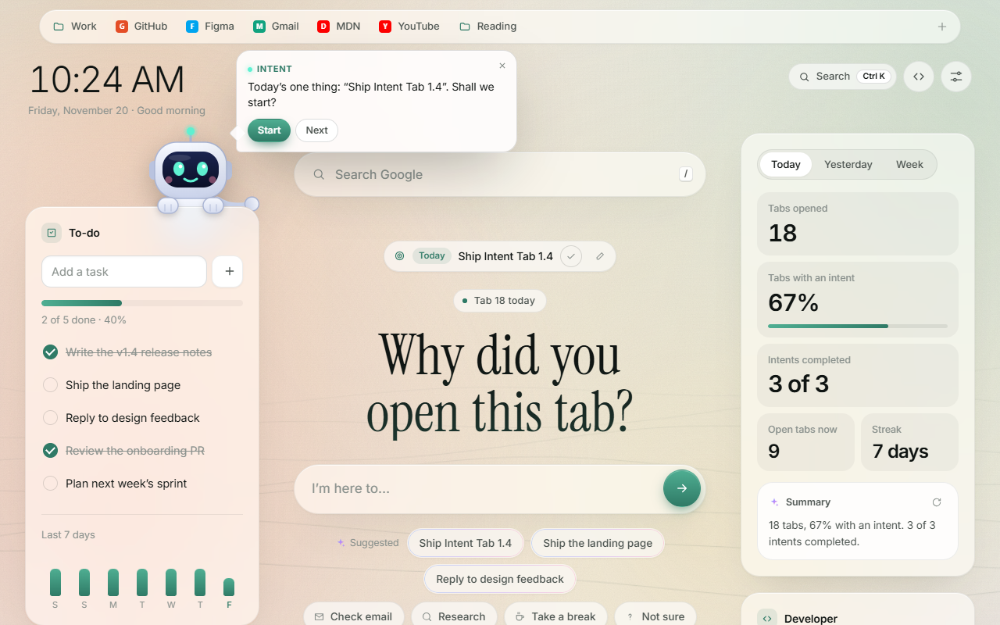
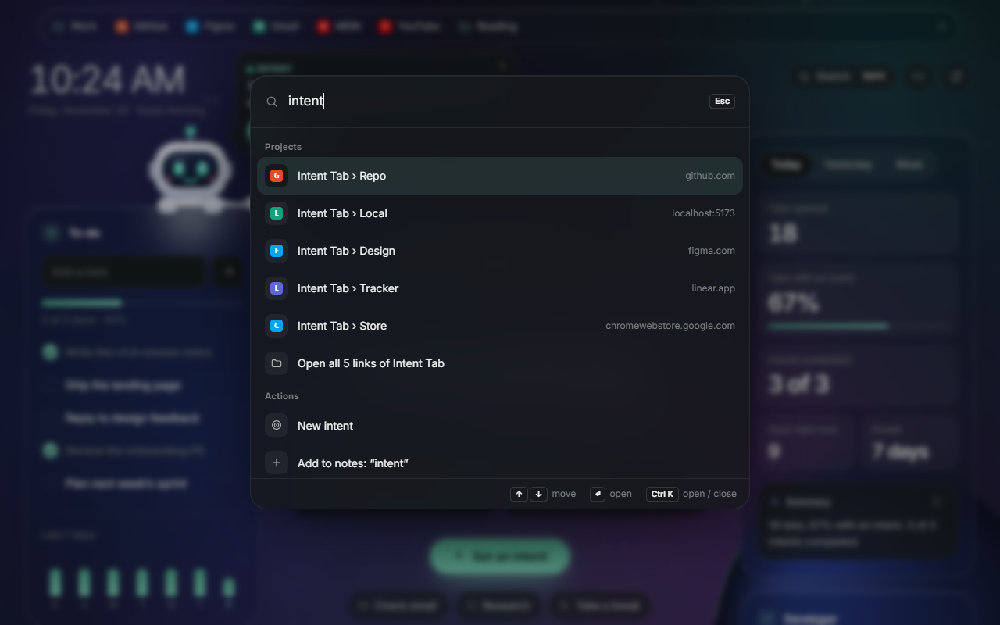
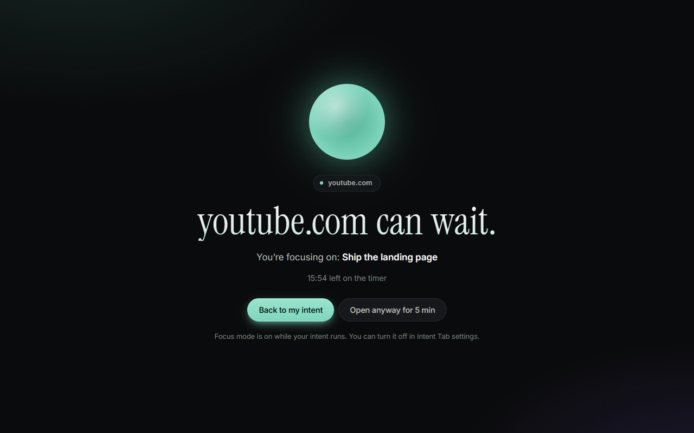

<div align="center">


# Intent Tab

### Why did you open *this tab?*

Your new tab, with a little robot that keeps you on track.<br>
It asks one quick question every time you open a tab, remembers the answer, and gently pulls you back when you drift.

**[🌐 Website](https://saykatghosh.github.io/intent_tab/)** · **[⬇️ Download .zip](https://saykatghosh.github.io/intent_tab/download/intent-tab.zip)** · **[▶️ Video tour](https://saykatghosh.github.io/intent_tab/#video)** · **[🔒 Privacy](https://saykatghosh.github.io/intent_tab/privacy.html)**


</div>

---

## 🤖 Meet your focus buddy

A tiny robot sits on your new tab. It remembers today's one thing and nudges you at the right moment, never nagging, always friendly. Its eyes even follow your cursor.

- **Reminds your intent.** Every new tab shows what you said you're here to do.
- **Suggests the next task.** Its bubble offers **Start** and **Next**.
- **Celebrates your streak.** It cheers when you finish something.

## 🔢 Small numbers, big focus

| **1** | **Ctrl K** | **5 min** | **2** |
|:-:|:-:|:-:|:-:|
| clear intent for every tab you open | to reach any project, link or action | is all a distraction gets in focus mode | moods: Cosmos and Daylight |

## 📸 Take the tour

| | |
|:---:|:---:|
|  |  |
| **Set an intent.** Every new tab asks why you're here. Type it, or tap a suggestion from your to-dos. | **Command palette.** Press Ctrl K to jump to any project link, start a new intent or add a quick note. |
|  |  |
| **Projects.** Tasks, progress and every link for a project in one place. Open all its links in one click. | **Focus mode.** *youtube.com can wait.* The sites you list are blocked while focus mode is on. |

▶️ **[Watch the 90-second video tour](https://saykatghosh.github.io/intent_tab/#video)** (Bangla voice-over and captions, with an install guide).

## 🚀 Ready in three steps

> Coming soon to the Chrome Web Store. Until then, install it from the .zip in about 30 seconds.

1. **Add to Chrome.** [Download the .zip](https://saykatghosh.github.io/intent_tab/download/intent-tab.zip) and unzip it (or clone this repository). Open **`chrome://extensions`**, turn on **Developer mode** (top right), click **Load unpacked** and pick the folder with `manifest.json`.
2. **Open a new tab.** Your robot says hi. If Chrome asks about the changed new tab page, choose **Keep it**. Pick Cosmos or Daylight.
3. **Set your first intent.** Type what you're here to do, and go do it.

After you edit a file, click ↻ on the extension card and open a new tab.

> **The bar under the page** ("Intent Tab · Customize Chrome") comes from Chrome itself. Chrome adds it to every extension's new tab, and extensions can't hide it. To turn it off: **Customize Chrome → Footer → turn off "Show footer"**. Intent Tab shows this tip once.

<details>
<summary><b>ইনস্টল (বাংলায়)</b></summary>

1. [.zip ফাইলটা ডাউনলোড করে](https://saykatghosh.github.io/intent_tab/download/intent-tab.zip) আনজিপ করুন (অথবা এই রিপোজিটরি clone করুন)।
2. Chrome-এ **`chrome://extensions`** খুলুন।
3. উপরে ডানদিকের **Developer mode** চালু করুন।
4. **Load unpacked** চাপুন, তারপর যে ফোল্ডারে `manifest.json` আছে সেটা সিলেক্ট করুন।
5. নতুন ট্যাব খুলুন। Chrome জিজ্ঞেস করলে **Keep it** চাপুন।

ভিডিওতে ধাপে ধাপে দেখানো আছে: [ভিডিও দেখুন](https://saykatghosh.github.io/intent_tab/#video)

</details>

## ❓ Questions? Answered.

<details><summary><b>Is Intent Tab free?</b></summary>

Yes, completely free. No account, no ads, no paid plan.
</details>

<details><summary><b>What does the robot do?</b></summary>

It shows today's one thing when you open a tab and offers to start it, or to move on to the next task.
</details>

<details><summary><b>How does focus mode work?</b></summary>

Add the sites you want to block (from the toolbar popup or Settings) and turn focus mode on. Those sites then show a calm "You're in focus mode" page instead. Go back, or open the site anyway for 5 minutes. Turn it off with one click in the popup.
</details>

<details><summary><b>Where is my data stored?</b></summary>

On your own computer, inside Chrome (`chrome.storage.local`). There are no servers, no analytics and no tracking. You can export a backup any time, and if you turn on sync in Settings, your to-dos, notes and projects follow you through your own Chrome sync. See the [privacy policy](https://saykatghosh.github.io/intent_tab/privacy.html).
</details>

## 🧭 Highlights

| | Feature | What it does |
|:-:|---|---|
| 🧩 | **Floating panel** | Click the robot in Chrome's toolbar on any site: a rounded panel floats over the page with the focus timer, today's one thing, to-dos and focus mode, and Intent the robot holds its edge. The icon always shows today's focus time. |
| 🎯 | **Intent question** | Type a reason or pick a chip. Your intent then shows large, with a focus timer and **Done**. |
| 🌌 | **Cosmos** | A deep-space sky with stars, a nebula, shooting stars and a ringed planet. In light mode it's a pastel sky. |
| 🤖 | **Intent, the robot** | A small robot that peeks over your To-do card, points at the next task and cheers when you finish one. |
| ✅ | **To-do and today's one thing** | Daily tasks with progress and a 7-day chart, plus one goal for the day. |
| 🗂️ | **Projects** | Links, tasks and progress for each project, in a popup that opens with one click. |
| ⏱️ | **Focus time** | Counts how long you really focused today, with a session count. |
| 🛡️ | **Focus mode** | While it's on, the sites you list redirect to a calm "You're in focus mode" page (not during breaks). |
| ⏳ | **Focus timer** | Start a 5, 10, 25 or 50-minute timer from the panel; today's total focus time shows on the toolbar icon. |
| 🧠 | **On-device AI** | Suggestions, a coach, a day summary and Ask AI, all from Gemini Nano on your computer. |
| ⌨️ | **Command palette** | Press Ctrl+K to search bookmarks, run tools, set intents and change settings. |
| 🛠️ | **Developer card** | Seven dev tools, search shortcuts and your projects on the page. |
| 🔖 | **Bookmarks bar** | A full bookmarks bar with folders, drag and drop, a right-click menu and custom icons. |
| 🌧️ | **Focus sounds** | Rain, ocean or fan noise, generated live with Web Audio. |

## 📖 Features in detail

<details>
<summary><b>🎯 Intent, timer and when to ask</b></summary>

- **Intent question.** Type a reason or pick a chip (*Check email, Research, Take a break, Not sure*). The intent then shows large, with a focus timer and **Done** / **New intent** buttons. The top line shows which tab of the day this is.
- **Timer length.** Choose 5, 10 (the default), 25 or 50 minutes in Settings, or switch under a running timer. After 20 or more minutes, **Take a 5-min break** appears.
- **When to ask** (Settings):
  - **Smart** (default): asks on the first tab after a break of more than 10 minutes.
  - **Always:** asks on every tab, with a *Continue: …* chip.
  - **Work hours:** like Smart, but only between the times you set.
  - **Off:** never asks.
  - *Don't ask for 1 hour* and *Not today* pause it, and **Esc** dismisses it.
- **The quiet centre.** When the question isn't asked, the middle of the page shows:
  - a greeting
  - your **next task** (▶ starts it as an intent)
  - your **focus time today**
  - a **Set an intent** button and quick-start chips
- **Focus time.** It's counted when an intent ends: when you press Done, start a new intent, or the timer runs out. It counts even when no tab is open, only up to the timer's end, never twice, and never for breaks.
- **Breathing breaks.** *Take a break* shows a breathing orb: in for 4 s, hold for 4 s, out for 6 s.
- **Notifications.** When the timer ends you get *Time's up*, with **Done** and **+5 min**.
- **Focus sounds.** Rain, Ocean or Fan, with volume. They keep playing in other tabs and stop when the timer ends.

</details>

<details>
<summary><b>✅ To-do, today's one thing and the report</b></summary>

- **To-do.** Add, tick and delete tasks, with a progress bar for today and a chart of the last 7 days. Finished tasks clear the next day; unfinished ones carry over.
- **Today's one thing.** *What would make today a good day?* It sits as a small pill with ✓ and ✎, and the AI takes it into account.
- **Report** (Today / Yesterday / Week) shows:
  - tabs opened
  - the share of tabs that had an intent
  - intents completed
  - tabs open right now
  - your streak

  **Week** adds a chart and an AI summary. It reports facts only, never judgement.
- **Notes.** A scratchpad card that saves as you type.
- **Rearrange cards.** Drag a card's ⠿ handle between the two columns. *Reset card layout* in Settings puts them back.

</details>

<details>
<summary><b>🗂️ Projects</b></summary>

Keep everything about a project in one place.

- **Create one.** Use **Edit** in the Developer card, *Settings → Developer → Projects…*, or Ctrl+K → *New project*. Each project starts with link slots for **Repo, Local, Staging, Production, Design and Tracker**. Fill in only what you need: `localhost:3000` and `github.com/me/app` both work.
- **In the Developer card.** Every project shows right after you create it, with a small progress bar (`3/5`), its link icons and ↗ to open all of its links.
- **Project view.** Click a project to open its popup:
  - a progress ring
  - a task list (add, tick, delete; finished tasks move down)
  - link cards with favicons
  - **Open all** and **Edit** buttons
- **Ctrl+K.** Type the project's name to open the project, any one of its links, or all of them.

</details>

<details>
<summary><b>🔖 Bookmarks bar and Most visited</b></summary>

- **The whole Bookmarks bar at the top of the page**, with icons:
  - Folders open as drop-downs, and sub-folders open inside them (‹ goes back, arrow keys move).
  - Items that don't fit go into **»**.
  - *Other bookmarks* and *Mobile bookmarks* sit on the right.
  - To hide Chrome's own bar, press **Ctrl+Shift+B**.
- **Add** a bookmark or a folder with **+**, or with *Add bookmark here* / *New folder here* in any folder menu. These are real Chrome bookmarks.
- **Right-click menu, like Chrome's:**
  - Open in a new tab, a new window or Incognito.
  - Edit, rename, change the icon, copy the link, delete, add a page or folder, open the Bookmark manager.
  - Deleting offers **Undo** for 7 seconds.
- **Drag and drop:**
  - Reorder bookmarks along the bar or inside menus.
  - Drop an item on a folder to move it inside, or hover over a folder until it springs open.
  - Drag a link from any page onto the bar to bookmark it.
- **Custom icons.** Use an emoji, your own image, or a background colour.
  - A name that starts with an emoji (`📁 Work`) uses that emoji as its icon.
  - You can also show the emoji in Chrome's own bar.
- **Most visited.** Your top sites in a centred dock. Right-click a site to open it, change its icon, copy its link or bookmark it.
- **Live sync with Chrome.** Changes in Chrome's Bookmark manager show on the page immediately, and the other way round.

</details>

<details>
<summary><b>🧠 On-device AI (Gemini Nano)</b></summary>

This runs entirely on your computer through Chrome's Prompt API. There's no API key and no server, and nothing leaves the device.

- **Smart suggestions.** *✦ Suggested* chips, based on your tasks, recent intents and the time of day.
- **AI coach.** It rewrites your intent as one clear goal, suggests a timer length and offers 2–3 tiny steps (**Add steps to to-do**).
- **Day summary.** A neutral summary in the report. ↻ rewrites it, and it's cached for 30 minutes.
- **Ask AI.** Type a question in the search bar and press **Tab** for an answer on the page. **Enter** still searches.
- **Without the model** everything still works, using simple built-in rules.
- **Requirements** come from Chrome: a recent desktop Chrome, free disk space for the model, and a capable GPU or enough RAM. Replies are in English for now.

</details>

<details>
<summary><b>🛠️ For developers</b></summary>

- **Developer card.** One-click buttons for the tools, your projects and search-shortcut chips. **&lt;/&gt;** in the top bar opens the tools from anywhere.
- **Search shortcuts.** Type a keyword, a space and your query. A hint shows where Enter will take you.

  | Keyword | Goes to | Keyword | Goes to |
  |---|---|---|---|
  | `mdn` | MDN | `dd` | DevDocs |
  | `npm` | npm | `pypi` | PyPI |
  | `gh` | GitHub (`gh owner/repo` opens the repo) | `crates` | crates.io |
  | `so` | Stack Overflow | `bundle` | Bundlephobia |
  | `can` | Can I use | `tw` | Tailwind |
  | `yt` | YouTube | `w` | Wikipedia |

- **Developer tools**, all local:
  - **JSON:** format, minify and validate.
  - **Encode:** Base64, URL encoding, and JWT decoding.
  - **Timestamp:** convert between timestamps and dates.
  - **Color:** HEX, RGB, HSL and OKLCH, plus WCAG contrast.
  - **Generate:** UUIDs and passwords.
  - **Regex:** a tester with highlighted matches.
  - **Units:** px ↔ rem, bytes, and time zones.
- **Instant answers in Ctrl+K:**

  | Type | You get |
  |---|---|
  | `2*(3+4)` | 14 |
  | a Unix timestamp | the date |
  | `#7fd6bd` | the RGB value |
  | `24px` | 1.5rem |
  | a JWT | the decoded token |
  | JSON | formatted JSON |

</details>

<details>
<summary><b>🎨 Look and feel</b></summary>

- **Backgrounds:**
  - **Cosmos** (default): stars, a nebula, shooting stars, a ringed planet and floating dust, leaning gently toward the mouse.
  - **Animated:** colour fields that follow the time of day.
  - **Still**, **Plain**, or your own **Photo** with a *Darken* slider.
- **Intent, the robot companion:**
  - It waves, blinks and follows your mouse with its eyes.
  - It points at the next task, and its bubble offers **Start** and **Next**.
  - It keeps watch while an intent runs and hops when you finish something.
  - Turn it off in *Settings → Show on page*.
- **Theme and accent.** System, Light or Dark, with a Sage, Ocean, Violet, Amber or Rose accent.
- **Motion:**
  - soft cross-fades
  - word-by-word reveals
  - a particle burst when you finish something
  - numbers that count up
  - a card spotlight
  - ripples on buttons

  All of it turns off when the system asks for reduced motion.
- **Welcome tour.** Three short steps on first run.

</details>

<details>
<summary><b>💾 Your data and sync</b></summary>

- **Export backup** downloads everything as JSON, and **Import backup** restores it. Settings shows when you last made one, and a gentle reminder appears after a week without a backup (a month with sync on).
- **Sync** copies settings, to-dos, notes and projects through Chrome sync, so they follow you to every Chrome signed in to your Google account and come back after a reinstall. The first time a computer joins, its data is merged, not replaced. History and the background photo stay on this computer. Chrome sync holds about 100 KB; Settings tells you if it's full.
- **Switching to another browser** (Edge, Brave, Firefox…) needs Export on the old one and Import on the new one. Chrome sync doesn't cross browsers.
- **Search engine.** Choose Google, Bing, DuckDuckGo, Brave, YouTube, Perplexity or ChatGPT.

</details>

## ⚡ Performance

A new tab page should never slow Chrome down.

- **Cosmos** paints its static layers (sky, nebula and planet) once into a cached canvas. Each frame only draws the stars, a meteor and some dust, at 24 FPS.
- **When the page is idle** (no input for a minute) or the window is in the background, the canvas and looping CSS animations **pause**. Any mouse or keyboard input wakes them.
- **Hidden tabs** don't animate at all, and with reduced motion only a single frame is drawn.
- **No live blur over moving backgrounds.** Cards use a frosted surface instead of `backdrop-filter`, the biggest GPU saving.
- **Pointer and resize handlers** run at most once per frame.

## 🔐 Permissions

| Permission | Why |
|---|---|
| `storage` | Save settings, intents, to-dos, notes, projects and daily counts locally |
| `bookmarks` | Show your bookmarks and let you edit them from the page |
| `favicon` | Show site icons via `chrome-extension://<id>/_favicon/` |
| `topSites` | Show your most visited sites |
| `alarms` | Wake up when the focus timer ends |
| `notifications` | Show the *Time's up* notification |
| `declarativeNetRequest` | Focus mode: redirect only the sites you listed, only while focus mode is on |
| `offscreen` | Play focus sounds in the background |
| `activeTab`, `scripting` | When you click the toolbar icon, show the floating panel on that page (nothing on the page is read) |
| optional `*://*/*` | Asked **per site** when you add it to focus mode, never otherwise |

> **No analytics.** The only request Intent Tab makes by itself is a daily check on GitHub for a newer version, and only in copies installed from the ZIP (the Web Store updates by itself). The search bar opens results from the engine you chose. Removing the extension deletes all of its data.

## 🧑‍💻 Development

There are no dependencies; you only need **Node 18+**.

```bash
npm run check        # manifest, JS syntax, imports, element ids, en/bn strings
npm run build        # check, then dist/intent-tab-v<version>.zip
npm run bump:patch   # 1.0.0 → 1.0.1   (also bump:minor, bump:major)
npm run release      # bump patch + check + zip in one go
```

The ZIP leaves out `store/`, `scripts/`, `.git`, `.github`, `package.json` and this README.
**CI:** [`.github/workflows/build.yml`](.github/workflows/build.yml) runs the same check and build on every push and pull request, and attaches the ZIP to the run.

**Releases are automatic.** Raise the version (`npm run bump:patch`), commit and push to `main`. [`.github/workflows/release.yml`](.github/workflows/release.yml) sees a version with no release yet, tags it, builds the ZIP and publishes a GitHub Release. To write the release notes yourself, add `.github/release-notes/v<version>.md` before pushing; otherwise GitHub lists the commits.

<details>
<summary><b>📁 Project structure</b></summary>

```
manifest.json
newtab.html            the page
popup.html             the panel (css/popup.css); floats over the page, or opens as a popup on chrome:// pages
background.js          service worker: focus-mode rules, timer notification, focus time, sounds
offscreen.html/.js     generates focus sounds (Web Audio)
blocked.html/.js       the calm page shown by focus mode
css/newtab.css         all styles
js/
  app.js               boot, theme, clock, module switching
  store.js             storage helpers, constants, focus-time tracking
  strings.js           all UI text, English (en) and Bangla (bn)
  intent.js            question / running intent / timer / quiet centre
  todos.js             to-do list and 7-day chart
  focus.js             today's one thing
  breathe.js           breathing guide for breaks
  report.js            daily and weekly report
  notes.js             notes card
  bookmarks.js         bookmarks bar and most visited
  icons.js             custom icons and the icon dialog
  contextmenu.js       the right-click menu
  projects.js          projects: links, tasks, progress, project view
  devcard.js           the Developer card
  tools.js             developer tools + instant answers
  search.js            search engines and shortcuts
  palette.js           command palette (Ctrl+K)
  ai.js                on-device AI wrapper (Prompt API)
  assistant.js         suggestions, coach, summary, Ask AI (+ rule fallbacks)
  background.js        Cosmos / animated canvas background
  robot.js             Intent, the robot companion
  effects.js           transitions, word reveal, count-up, burst, ripple, idle pause
  layout.js            drag cards between columns
  prefs.js             engine, accent, photo, focus sites, sync, export/import, backup reminder, sounds
  sync.js              to-dos, notes and projects through Chrome sync (run by the service worker)
  settings.js          settings panel
  popup.js             the panel: focus timer, one thing, to-dos, focus mode, robot
  panel-inject.js      puts the panel on the current page when the toolbar icon is clicked
  robot-svg.js         the robot drawing, shared by the page and the popup
  onboarding.js        welcome tour
  theme-boot.js        sets theme and accent before first paint
fonts/                 Inter + Instrument Serif (WOFF2, OFL), bundled, no web requests
icons/                 16, 48, 128 px, rendered from docs/assets/robot.svg
scripts/build.mjs      check / bump / zip
docs/                  the website (GitHub Pages): index.html, privacy.html, screenshots, video, download
store/                 Web Store listing, privacy policy, promo tiles
```

</details>

<details>
<summary><b>🗄️ Stored data</b></summary>

All of it is in `chrome.storage.local`, under these keys:

| Key | What it holds |
|---|---|
| `settings` | Your settings |
| `intent` | The running intent |
| `ask` | Last tab time and snooze |
| `todos` | Your to-dos |
| `notes` | The notes card |
| `focus` | Today's one thing |
| `focusAllow` | Sites opened "anyway" for 5 minutes |
| `projects` | Projects: links and tasks |
| `sound` | Focus sound choice |
| `bgPhoto` | Your background photo |
| `icons` | Custom icons |
| `history` | Recent intents |
| `aiCache` | Cached AI suggestions and summaries |
| `ui` | Small interface states |
| `days` | Per-day counts, including focus time, kept for 60 days |

</details>

## 🌐 Language: English / বাংলা

Switch in **Settings → Language**. It changes instantly, including Bangla digits in numbers and dates.

- **Change wording:** all text is in [`js/strings.js`](js/strings.js), in the `en` and `bn` blocks.
- **Add a third language:**
  1. Copy the `en` block and translate it.
  2. Add the language's locale to `LOCALES`.
  3. Add a button for it in `newtab.html`.

## 🏪 Publishing to the Chrome Web Store

Everything you need is in [`store/`](store/):

- **Listing text:** [`listing.md`](store/listing.md) has the descriptions (English and বাংলা), a justification for each permission, and the data-usage answers.
- **Privacy policy:** publish [`privacy-policy.md`](store/privacy-policy.md) at a public URL first, after adding your contact email to it.
- **Images:**
  - screenshots (1280×800) in [`docs/assets/shots/`](docs/assets/shots/)
  - promo tiles in [`store/`](store/)
  - `icons/icon128.png` as the store icon

Raise the version with `npm run bump:patch`, run `npm run build`, then upload `dist/intent-tab-v<version>.zip`.

## 📜 Credits

- **Fonts:** [Inter](https://github.com/rsms/inter) and [Instrument Serif](https://github.com/Instrument/instrument-serif), under the SIL Open Font License 1.1. See [`fonts/LICENSE.txt`](fonts/LICENSE.txt).
- **Focus sounds:** made live with Web Audio. No audio files are shipped.

<div align="center">
<br>
<sub><b>Your robot is waiting.</b> · <a href="https://saykatghosh.github.io/intent_tab/">saykatghosh.github.io/intent_tab</a></sub>
</div>
